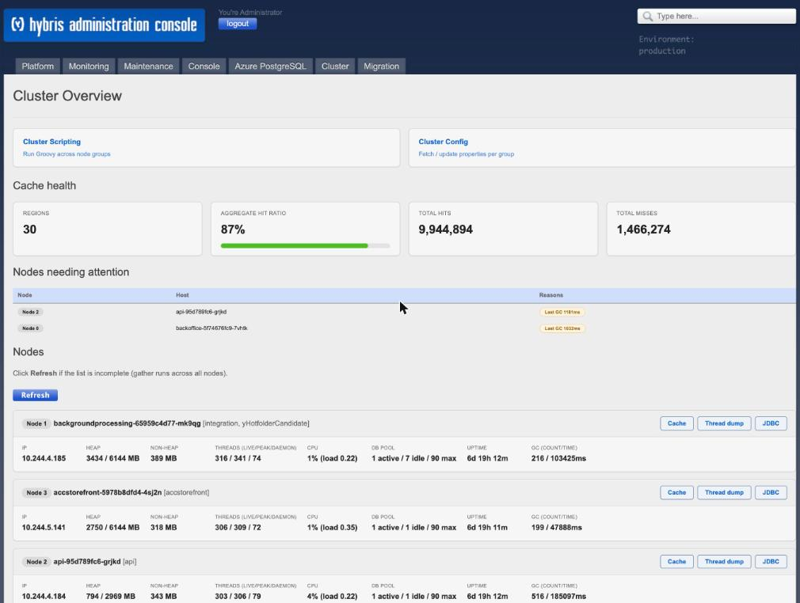
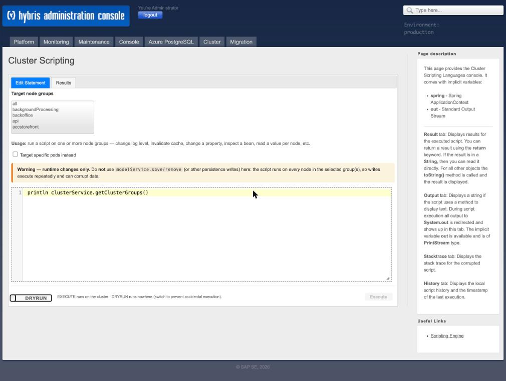
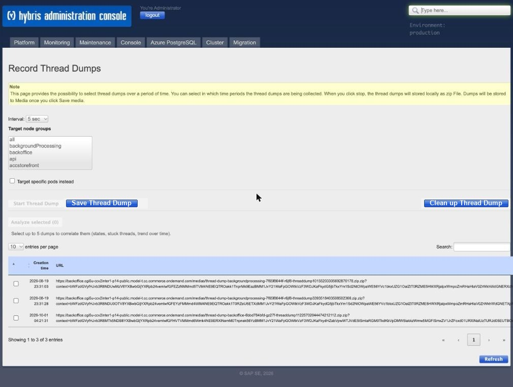
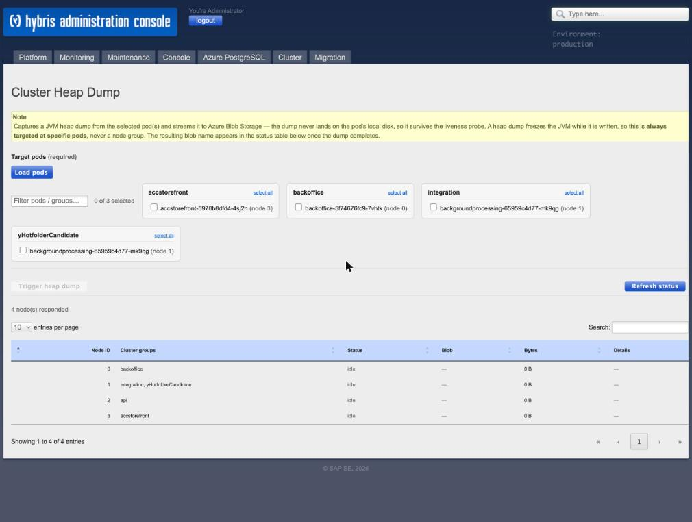
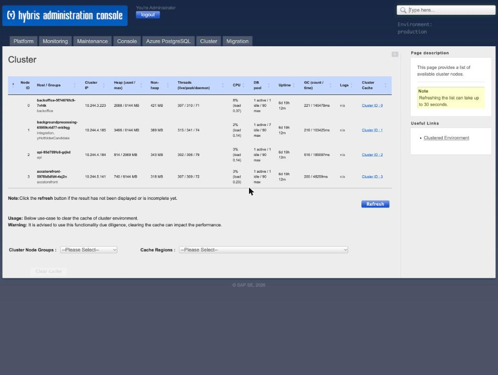
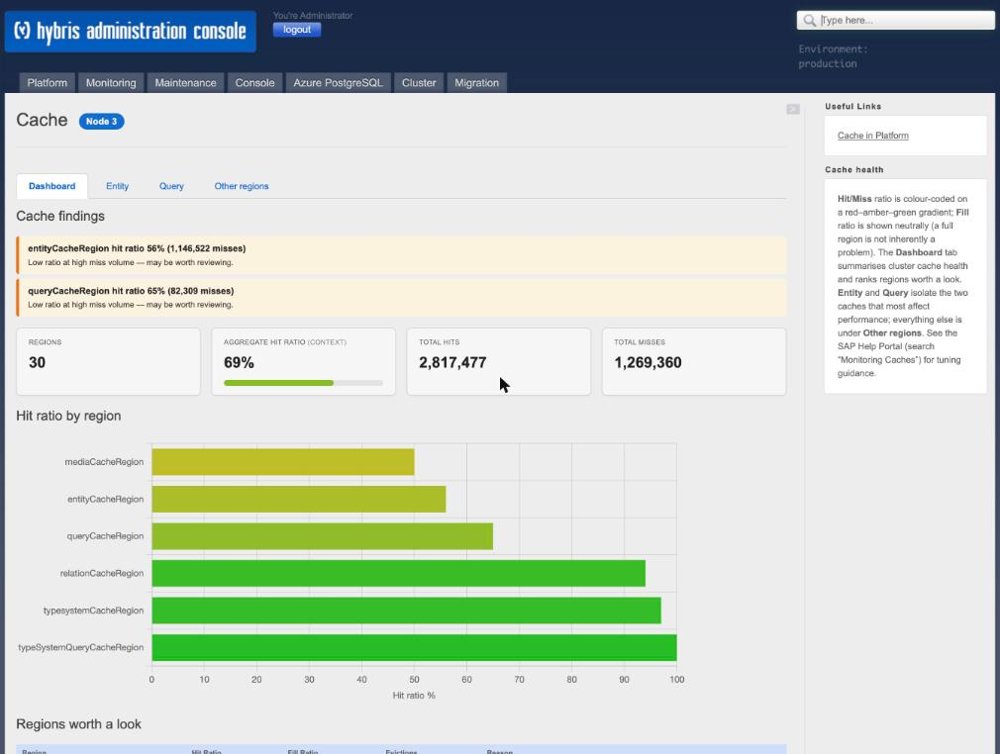
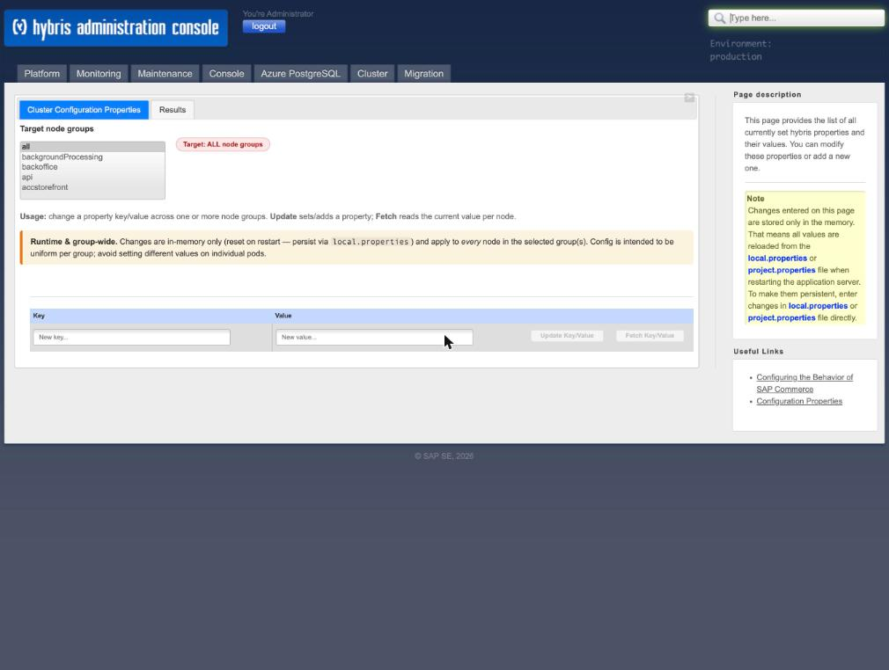
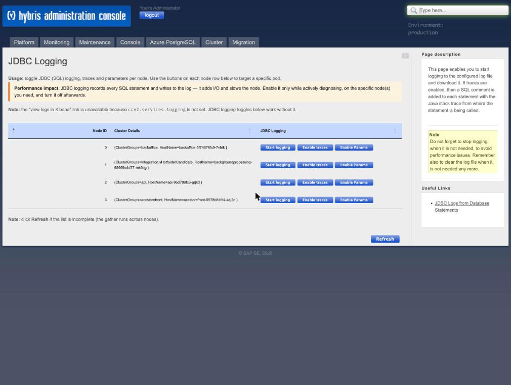

# HAC Cluster Aware Extension (ClusterHAC)

[](https://api.reuse.software/info/github.com/SAP-samples/sap-commerce-clusterhac)

## Description

Hybris Administration Console (HAC) is an essential tool for managing and monitoring an SAP Commerce Cloud infrastructure. In a CCv2 environment, HAC cannot be deployed on frontend (API) or background processing nodes, which makes it difficult to apply the same changes — property configuration, script execution, cache management, thread dumps, JDBC logging — across all nodes simultaneously.

The **ClusterHAC** extension adds a **Cluster** menu to HAC, providing a single interface to update and monitor every node in a cluster without manual per-node intervention. Actions can target all nodes, a specific node group, or individually selected pods.

### Features

| Page | URL | Purpose |
|---|---|---|
| [Cluster Overview](#1-cluster-overview) | `/hac/cluster/overview` | Cluster health landing page |
| [Cluster Scripting](#2-cluster-scripting) | `/hac/cluster/scripting` | Run a Groovy script on node groups or pods |
| [Cluster Thread Dump](#3-cluster-thread-dump) | `/hac/cluster/thread-dump` | Record thread dumps over time and analyse them |
| [Cluster Heap Dump](#4-cluster-heap-dump) | `/hac/cluster/heap-dump` | Stream a JVM heap dump to Azure Blob Storage |
| [Cache Monitoring](#5-cache-monitoring) | `/hac/cluster/monitoring` | Per-node JVM metrics, cache dashboards and cache clearing |
| [Cluster Config](#6-cluster-config) | `/hac/cluster/config` | Fetch or update runtime properties for each group |
| [JDBC Log](#7-jdbc-log) | `/hac/cluster/database` | Turn SQL logging, traces and parameters on or off per node |

## Requirements

- SAP Commerce Cloud (CCv2)
- HAC module enabled
- Cluster environment with multiple nodes

## Download and Installation

1. Copy the `clusterhac` extension folder (in this repository) into `hybris/bin/custom/`.
2. Add `clusterhac` to the `localextensions.xml`:
   ```xml
   <extension name="clusterhac" />
   ```
3. Run a system update or build and deploy.

## Configuration

### Node Groups

The extension targets the node groups defined by the following property (default value shown):

```properties
hac.cluster.node.groups=backgroundProcessing,backoffice,api,accstorefront
```

Override this in `local.properties` to match your cluster topology.

### Cache Statistics

Region hit/miss statistics are only recorded when cache stats are enabled. Without this, region sizes still show but hit-ratio metrics do not:

```properties
regioncache.stats.enabled=true
```

### Pinned Cache Regions (optional)

Nominate up to five cache regions to surface in their own Cache Monitoring sub-tab:

```properties
clusterhac.cache.pinnedRegions=cmsCacheRegion,productCacheRegion
```

### CLS (Cloud Log Service) Integration

To enable CLS dashboard links for each node in the Overview and Cache Monitoring views, configure the CLS endpoint:

```properties
ccv2.services.logging=https://<your-cls-url>
```

The toggles and metrics still work without it; only the "view logs in CLS" links are disabled.

## Navigation Model

- **Cluster Overview is the hub.** It shows a card per node in the cluster, with shortcuts into that node's Cache, Thread Dump and JDBC pages.
- **Group operations** (Scripting, Config) target one or more node groups, or specific pods.
- **Pod-only operations** (Heap Dump) always target individually selected pods.

Results are collected asynchronously; each node responds independently and the output is gathered back into HAC.

---

## 1. Cluster Overview



The landing dashboard for the whole cluster.

- **Quick links** to Cluster Scripting and Cluster Config.
- **Cache health tiles** aggregate figures across all nodes: number of regions, aggregate hit ratio (with a progress bar), total hits and total misses.
- **Nodes needing attention** lists only nodes that have crossed a threshold (high CPU, heap near max, DB pool saturated, long GC pause), with the reason shown as a badge — so a large cluster collapses to the few nodes worth looking at.
- **Node cards** show, per pod: IP, heap used/max, non-heap, threads (live/peak/daemon), CPU % and load, DB pool (active/idle/max), uptime, and GC count/time. Each card has **Cache**, **Thread dump** and **JDBC** shortcuts that open that pod in the matching page.
- **Refresh** re-runs the data gather across all nodes.

**Typical use:** a first look during an incident to find which pod has heap, GC, thread or DB-pool pressure.

---

## 2. Cluster Scripting



A Groovy scripting console that runs the same script on one or more node groups, or on specific pods — at runtime, without restarting the server.

- **Target node groups** is a multi-select list; **Target specific pods instead** switches to choosing individual pods.
- **Edit Statement / Results tabs:** a code editor and the per-node output, split across Result, Output, Stacktrace and History tabs.
- **Implicit variables:** `spring` (the `ApplicationContext`) and `out` (a `PrintStream`).
- **DRYRUN / EXECUTE switch:** DRYRUN (the default) runs nowhere, preventing accidental execution. Switch to EXECUTE to run on the cluster.

Use cases:
- Change a log level or inspect a bean on every node
- Invalidate a cache or read a configuration value per node
- Execute a drools or data-inspection script across a node group

> ⚠️ **Runtime changes only.** Do not use `modelService.save/remove` or any other persistence write here. The script runs on *every* node in the selected groups, so a write runs repeatedly and can corrupt data. Keep DRYRUN on until you are ready.

---

## 3. Cluster Thread Dump



Captures a series of thread dumps over a period of time from the selected node groups or pods.

- **Interval:** configurable (e.g. 5 s, 10 s, 30 s, 60 s, 5 min, 15 min, 30 min).
- **Start / Stop:** when you stop, the dumps are packaged as a zip file.
- **Save Thread Dump** stores the zip as a Commerce Media for later download; **Clean up Thread Dump** removes stored dump media.
- **History table:** creation time and media URL, with **Download** and **Analyze** actions per row.
- **Analyze selected (max 5):** compares several dumps together and summarises the findings — thread states, stuck threads, lock contention and the trend over time.

**Typical use:** diagnosing hung requests, lock contention or thread-pool exhaustion. Take 3–5 dumps a few seconds apart and compare them with Analyze.

---

## 4. Cluster Heap Dump



Captures a JVM heap dump from one or more selected pods and streams it straight to an Azure Blob Storage container. The dump never lands on the pod's local disk, so it survives the Kubernetes liveness probe and does not depend on local disk capacity.

- **Target pods (required):** click **Load pods**, then tick pods inside each group card. The cards have a filter box and select-all links.
- **Trigger heap dump** stays disabled until at least one pod is selected.
- **Status table:** node ID, cluster groups, status, blob name, bytes written and details. **Refresh status** updates it; the blob name appears once the dump completes.

Blobs are written as `<container>/<host>/<host>_<user>_<timestamp>.hprof[.gz]`, where `<user>` is the HAC user who triggered the dump.

**Configuration:**

| Property | Default | Description |
| --- | --- | --- |
| `clusterhac.heapdump.azure.connection-string` | *(blank)* | Azure Blob connection string. If blank, falls back to `azure.hotfolder.storage.account.connection-string` (the CCv2 hotfolder account). |
| `clusterhac.heapdump.azure.container` | `memory-dump-container` | Target container (created if missing). |
| `clusterhac.heapdump.gzip` | `1` | Gzip level (1=fastest … 9=strongest, 0=off). |

> ⚠️ A heap dump **freezes the JVM while it is being written**. For that reason it can only target specific pods, never a whole node group. In production, take the pod out of traffic first or choose a quiet period, and dump one pod at a time.

> **Note:** the connection string contains the account key and is readable from HAC's Configuration tab. Keep the real value in `local.properties` (not committed) or use a scoped SAS token.

See [clusterhac/docs/heap-dump.md](clusterhac/docs/heap-dump.md) for the full design, internals, and troubleshooting.

---

## 5. Cache Monitoring



A cluster node table plus controls for clearing the cache on each group.

- **Node table:** node ID, host/groups, cluster IP, heap used/max, non-heap, threads, CPU/load, DB pool, uptime, GC count/time, logs, and a **Cluster Cache** link per node that opens the per-node dashboard.
- **Clear cache:** choose a **Cluster Node Group** and a **Cache Region** (or `all`), then click **Clear cache**.

### 5a. Per-node cache dashboard



**URL:** `/hac/cluster/monitoring/cache/{nodeId}`

- **Tabs:** Dashboard, Entity, Query, any pinned regions, and Other.
- **Cache findings** are generated automatically, flagging regions worth attention (e.g. low hit ratio at high miss volume).
- **KPI tiles:** regions, aggregate hit ratio, total hits and total misses.
- **Hit ratio by region:** a bar chart on a red–amber–green scale.
- **Regions worth a look:** a table of hit ratio, fill ratio, evictions and reason.
- **Clear entire cache (node):** requires ticking **Enable cache clearing** first. Each region also has its own clear button on the Entity, Query and Other tabs.

Use cases:
- Clear a single over-full region without flushing the whole cache
- Spot a low hit-ratio region before it becomes a DB hotspot

> ⚠️ Clearing a cache causes a cold-start penalty, with DB load until the cache warms up again. Clear one region at a time where possible.

---

## 6. Cluster Config



Reads or changes a configuration property at runtime on every node in the selected groups.

- **Target node groups** multi-select, with a badge showing the current target.
- **Fetch Key/Value** reads the current value on each node — use it to spot configuration drift between pods.
- **Update Key/Value** sets or adds the property across the group.
- The **Results** tab shows the response from each node.

Use cases:
- Change an endpoint URL only in Storefront nodes
- Toggle a feature flag in the API node group while leaving Backoffice unaffected

> ⚠️ **Runtime and group-wide.** Changes live only in memory and reset on restart. To make a change persistent, put it in `local.properties` / `project.properties` (in CCv2, the `manifest.json` or the Cloud Portal properties). Keep config consistent across a group rather than setting different values on individual pods.

---

## 7. JDBC Log



Turns SQL statement logging on and off for each node. One row per node shows its cluster groups and host name, with three toggles:

| Toggle | Property | Effect |
| --- | --- | --- |
| **Start logging** | `db.log.active` | Writes every SQL statement to the JDBC log |
| **Enable traces** | `db.log.appendStackTrace` | Adds a Java stack-trace comment showing where each statement was called from |
| **Enable Params** | `db.log.sql.parameters` | Logs the bound parameter values |

**Refresh** re-runs the gather on all nodes. A *view logs in CLS* link is available when `ccv2.services.logging` is configured.

> ⚠️ **Performance impact.** JDBC logging adds I/O and slows the node. Enable it only on the node you are diagnosing, only for as long as you need it, then turn it off. Changes applied via HAC are runtime-only and reset on restart.

---

## Recommended Diagnostic Flow

1. **Overview:** find the unhealthy pod (GC, heap, threads or DB pool).
2. **Cache Monitoring → node dashboard:** check for low hit ratios or evictions.
3. **Thread Dump:** for a hang or slowness, take several dumps and run **Analyze**.
4. **JDBC Log:** for slow SQL, log briefly on one node, with traces if needed.
5. **Heap Dump:** for memory leaks or OOM, dump one pod to Blob Storage.
6. **Config / Scripting:** apply a runtime-only fix (log level, property, cache invalidation). Keep DRYRUN on until ready.

## Safety Summary

| Action | Impact | Mitigation |
|---|---|---|
| Heap dump | JVM freezes while writing | One pod at a time, off-peak or with the pod out of traffic |
| Cluster scripting | Runs on every node in the group | DRYRUN first, no persistence writes |
| Clear cache | DB load spike while the cache warms up | Clear one region, not all |
| Config update | In-memory, lost on restart | Persist through properties or the manifest |
| JDBC logging | I/O overhead | One node, short window, turn it off afterwards |

## Architecture

ClusterHAC uses SAP Commerce's cluster event system: an action is broadcast to the target nodes, each node executes it independently, and the results are gathered back asynchronously and shown in HAC. No agent or extra infrastructure is required on the nodes.

## Known Issues

No known issues.

## How to Obtain Support

[Create an issue](https://github.com/SAP-samples/sap-commerce-clusterhac/issues) in this repository if you find a bug or have questions about the content.

For additional support, [ask a question in SAP Community](https://answers.sap.com/questions/ask.html).

## Code of Conduct

All members of the project community must abide by the [SAP Open Source Code of Conduct](https://github.com/SAP-samples/.github/blob/main/CODE_OF_CONDUCT.md). Only by respecting each other can we develop a productive, collaborative community. Instances of abusive, harassing, or otherwise unacceptable behavior may be reported by contacting a project maintainer or [ospo@sap.com](mailto:ospo@sap.com).

## Contributing

If you wish to contribute code, offer fixes or improvements, please send a pull request. Due to legal reasons, contributors will be asked to accept a DCO when they create the first pull request to this project. This happens in an automated fashion during the submission process. SAP uses [the standard DCO text of the Linux Foundation](https://developercertificate.org/). See [CONTRIBUTING.md](CONTRIBUTING.md) for details.

## Disclaimer

Customer agrees to use ClusterHAC on an "as is" basis. SAP makes no guarantees, representations, or warranties of any kind, express or implied, arising by law or otherwise, including but not limited to content, quality, accuracy, completeness, effectiveness, reliability, fitness for a particular purpose, usefulness, use or results to be obtained from ClusterHAC, or that ClusterHAC will be uninterrupted or error-free.

## License

Copyright 2026 SAP SE or an SAP affiliate company and sap-commerce-clusterhac contributors. Please see our [LICENSE](LICENSE) for copyright and license information. Detailed information including third-party components and their licensing/copyright information is available [via the REUSE tool](https://api.reuse.software/info/github.com/SAP-samples/sap-commerce-clusterhac).
